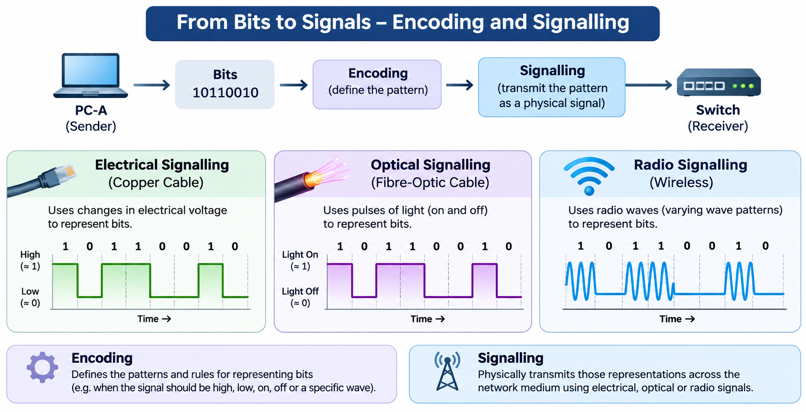

# 🌐 4.2 Physical Layer Characteristics

**Cisco Networking Academy | Solent University**

**Course:** CCNA: Introduction to Networks  
**Module:** 04 - Physical Layer  
**Focus Area:** Physical Layer Standards, Components, Encoding, Signalling and Bandwidth

## 🎯 Objective

Understand the characteristics of the Physical Layer, including the standards and hardware used for network connections, how bits are encoded and transmitted as signals, and how network performance is measured.

## 🧠 4.2.1 Physical Layer Standards

The **Physical Layer (Layer 1)** defines how bits are transmitted across network media.

To ensure equipment from different manufacturers can communicate, network connections follow **international standards**.

These standards define characteristics such as:

- **Physical components:** Cables, connectors and network interfaces.
- **Encoding:** How bits are represented using defined patterns.
- **Signalling:** How signals are transmitted over the medium.

### Standards Organisations

Several organisations develop standards relevant to the Physical Layer.

| Organisation | Role |
|---|---|
| **IEEE** | Develops networking standards, including Ethernet (IEEE 802.3) and Wi-Fi (IEEE 802.11). |
| **TIA/EIA** | Develops telecommunications cabling and infrastructure standards. |
| **ISO** | Develops international standards, including standards relevant to networking. |
| **ITU-T** | Develops telecommunications standards, including those used in optical and broadband communication. |

> NOTE: In addition, there are regional cabling standards groups which develop local specifications. 
> Examples: Canadian Standards Association, European Committee for Electrotechnical Standardization, and Japanese Standards Association

## 🧠 4.2.2 Physical Components

Physical components are the **hardware and media used to establish network connections**.

They include:

- **Network Interface Cards (NICs):** Provide network connectivity.
- **Cables:** Carry electrical or optical signals.
- **Connectors:** Join cables to network interfaces.
- **Network ports:** Provide connection points on switches, routers and other devices.
- **Wireless antennas:** Transmit and receive radio signals.

### Common Network Media

| Medium | Signal Type | Example |
|---|---|---|
| Copper cable | Electrical signals | Ethernet twisted-pair cable |
| Fibre-optic cable | Light signals | Fibre connection between switches |
| Wireless | Radio signals | Laptop connected through Wi-Fi |

## 🧠 4.2.3 Encoding

**Encoding** is the process of converting bits into a defined pattern that the receiving device can recognise.

**Example:** PC-A needs to transmit the bits `10110010`.
- An encoding scheme determines how those bits should be represented for transmission.
- Depending on the technology, encoding may use specific patterns or signal transitions (such as changes between high and low levels) to help the receiver recognise the data and stay synchronised with the sender.

## 🧠 4.2.4 Signaling

**Signalling** is the process of physically transmitting the encoded information across the network medium.

The type of signal depends on the connection:
- **Copper cables:** Electrical signals.
- **Fibre-optic cables:** Light signals.
- **Wireless connections:** Radio signals.

### Example: PC-A → Switch
1. **Data Link Layer:** Prepares an Ethernet frame containing bits.
2. **Encoding:** Defines the pattern used to represent the bits (for example, when a signal should change between high and low levels).
3. **Signalling:** Physically produces and transmits those electrical signal changes through the Ethernet cable.
4. **Receiving Switch:** Detects the signals, decodes them and recovers the bits.

> Encoding: Defines the patterns and rules for representing bits.
> Signalling: Physically transmits those representations across the network medium using electrical, optical or radio signals.

## 🧠 4.2.5 Bandwidth

**Bandwidth** describes the capacity of a network medium to carry data, measured by the number of bits that can be transmitted in a given amount of time.

Different physical media support different data transfer rates.

In networking, digital bandwidth is commonly expressed in **bits per second (bps)**.

### Common Bandwidth Measurements

| Unit | Meaning |
|---|---|
| bps | Bits per second |
| Kbps | Kilobits per second (1,000 bps) |
| Mbps | Megabits per second (1,000,000 bps) |
| Gbps | Gigabits per second (1,000,000,000 bps) |
| Tbps | Terabits per second (1,000,000,000,000 bps) |

**⚠️ Example:**

- A network interface operating at **1 Gbps** supports a nominal data rate of **one billion bits per second**.
- However, this does not mean an application will always transfer useful data at that rate.
- Actual performance depends on factors such as **network congestion, protocol overhead and the capabilities of connected devices**.

> **NOTE:** Bandwidth describes the capacity of a connection, not necessarily the actual data transfer rate experienced by an application.

## 🧠 4.2.6 Bandwidth Terminology

Terms used to measure the network performance:

### Latency

**Latency** is the time required for data to travel from one point to another.

It is commonly measured in **milliseconds (ms)**.

**Example:** A packet takes 20 ms to travel from one device to another.

⚠️ Lower latency is particularly important for applications such as video calls and online gaming.

### Throughput

**Throughput** is the actual rate at which data is successfully transferred across a network during a given period.

It is commonly measured in bps, Mbps or Gbps.

⚠️ Throughput can be lower than the available bandwidth because of congestion, errors, protocol overhead or other limitations.

### Goodput

**Goodput** is the rate of useful application data successfully delivered, excluding protocol overhead and retransmitted data.

**Example:**
A network connection has:
- **Bandwidth:** 100 Mbps
- **Throughput:** 80 Mbps
- **Goodput:** 72 Mbps

### Comparison

| Term | What It Measures |
|---|---|
| **Bandwidth** | How much the connection can carry. |
| **Latency** | The time taken for data to travel between points. |
| **Throughput** | How much data is actually transferred |
| **Goodput** | How much useful data is actually delivered. |

> **Easy Way to Remember:** Bandwidth is the total capacity, throughput is what actually gets transferred, and goodput is the useful data received.

## 📌 Key Concepts to Remember

- **Physical Layer Standards:** Ensure compatible network equipment can communicate.
- **Physical Components:** Include NICs, cables, connectors, ports and antennas.
- **Encoding:** Defines how bits are represented using agreed patterns.
- **Signalling:** Transmits those representations as electrical, optical or radio signals.
- **Bandwidth:** Describes the nominal data-carrying capacity of a connection.
- **Latency:** Measures the time required for data to travel.
- **Throughput:** Measures the actual successful data transfer rate.
- **Goodput:** Measures useful data is actually delivered.

## 🔐 Security Relevance

- **Physical Tampering:** Attackers with access to cables, ports or network equipment may disrupt communications.
- **Signal Interception:** Poorly protected copper or wireless connections may be vulnerable to interception.
- **Network Availability:** Damaged cabling, interference or congestion can reduce throughput and interrupt services.
- **Denial-of-Service (DoS):** Excessive traffic can consume available bandwidth and affect legitimate users.
- **Performance Monitoring:** Unexpected changes in throughput or latency may help identify faults or suspicious network activity.