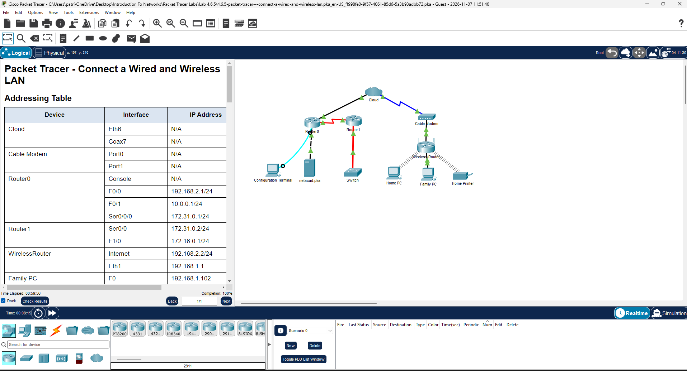

# Lab 01: Connect a Wired and Wireless LAN

**Cisco Networking Academy | Solent University**

**Course:** CCNA: Introduction to Networks  
**Platform:** Cisco Packet Tracer  
**Focus Area:** Physical Layer, Network Cabling & Wired/Wireless LAN Connectivity

## 🎯 Objective

Connect network devices using the appropriate cables and interfaces in Cisco Packet Tracer.

Verify network connectivity and explore the differences between logical and physical network topologies.

## 🧪 Lab Implementation

### Part 1: Connect Network Devices

Connected the devices according to the network topology using the appropriate cable types.

| Connection | Cable Type |
|---|---|
| Router0 → Cloud | Copper Straight-Through |
| Cloud → Cable Modem | Coaxial |
| Router0 → Router1 | Serial |
| Router0 → netacad.pka | Copper Cross-Over |
| Router0 → Configuration Terminal | Console |
| Router1 → Switch | Copper Straight-Through |
| Cable Modem → Wireless Router | Copper Straight-Through |
| Wireless Router → Family PC | Copper Straight-Through |

**Observation:** The connections used different cable types depending on the devices and interfaces. Active network links were indicated by green status lights.



### Part 2: Verify Network Connectivity

Tested the network connections using the available devices and tools.

- Used `ping` to test communication between the Family PC and `netacad.pka`.
- Opened `http://netacad.pka` using the Family PC web browser.
- Tested connectivity to the switch using its IP address.
- Accessed Router0 through the Configuration Terminal and executed:

```cisco
show ip interface brief
```

**Observation:** The connectivity tests and router interface information were used to verify the network connections.

### Part 3: Examine the Physical Topology

Switched from the Logical Workspace to the Physical Workspace in Packet Tracer.

Explored the Cloud, Primary Network, Secondary Network, and Home Network to examine how devices and cables are physically arranged.

**Observation:** The Logical Workspace shows how devices are connected, while the Physical Workspace represents their placement and cabling in a real-world environment.

## 🧰 Tools Used

- Cisco Packet Tracer
- Copper Straight-Through and Cross-Over cables
- Coaxial, Serial and Console cables
- Command Prompt (`ping`)
- Web Browser
- Cisco IOS (`show ip interface brief`)

## 🔐 Security Relevance

- Correct cabling and interface connections are essential for reliable network communication.
- Console connections provide local access for network device configuration and troubleshooting.
- Verifying connectivity and interface status helps identify network configuration and connection issues.

## 📌 Lessons Learned

- Identified appropriate cable types for different network connections.
- Connected routers, switches, computers and wireless networking devices.
- Used connectivity tests and Cisco IOS commands to check network connections.
- Explored the differences between logical and physical network topologies.