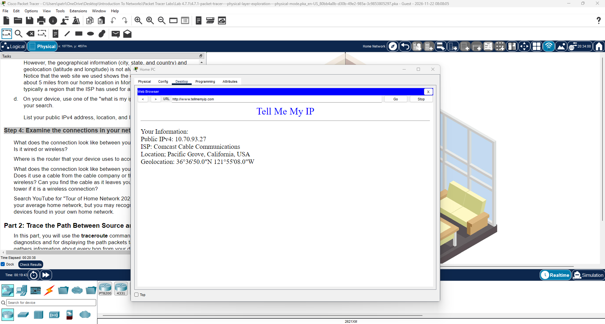
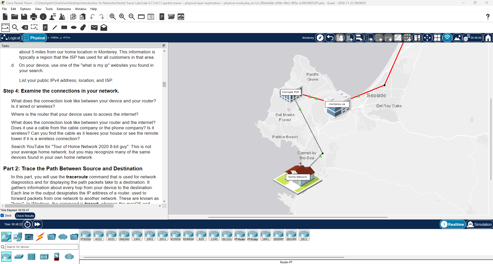
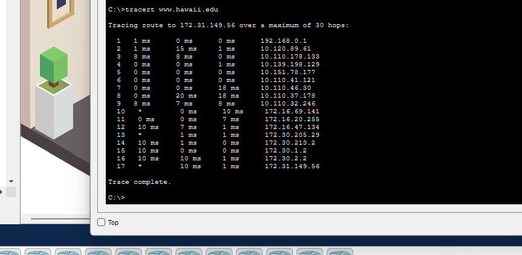
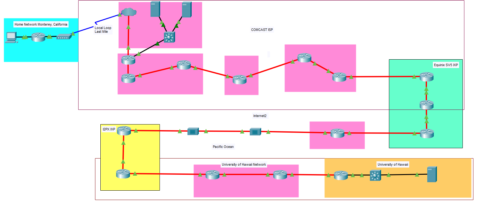
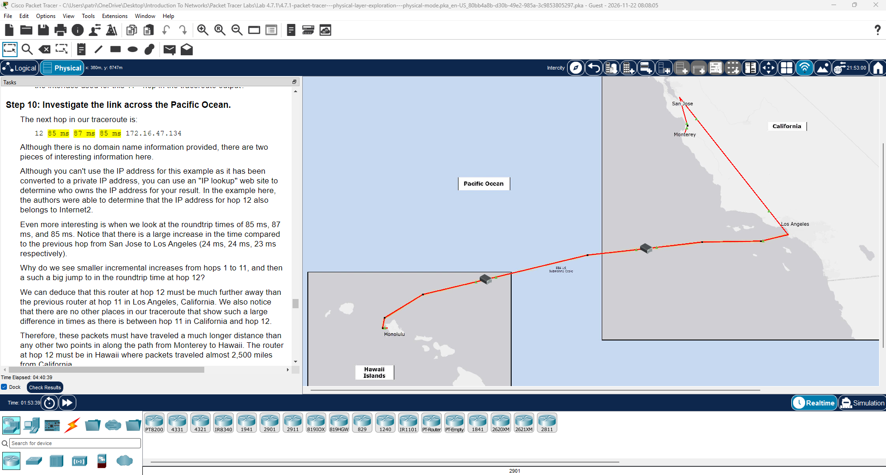

# Lab 02: Physical Layer Exploration - Physical Mode

**Cisco Networking Academy | Solent University**

**Course:** CCNA: Introduction to Networks  
**Platform:** Cisco Packet Tracer  
**Focus Area:** Physical Layer, IP Addressing, Traceroute & Network Infrastructure

## 🎯 Objective

Explore how data travels between devices across local and remote networks using Cisco Packet Tracer's Physical Mode.

Identify local IP addressing information and trace the physical path of packets between a home network in Monterey, California, and the University of Hawaii.

## 🧪 Lab Implementation

### Part 1: Examine Local IP Addressing Information

#### Step 1: What is my IPv4 address and IPv4 router address?

Opened the Home PC in Packet Tracer and used the Command Prompt to examine its network configuration: `ipconfig`

Identified the PC's private IPv4 address, subnet mask and default gateway.

```text
IPv4 Address....................: 192.168.0.75
Subnet Mask.....................: 255.255.255.0
Default Gateway.................: :: 192.168.0.1
```
#### Step 2: What is my public IPv4 address?

Used the simulated web browser to visit `www.tellmemyip.com` and examine the public IPv4 address and ISP information.



#### Step 3: Examine the Connections in Your Network

Explored the physical connections between the Home PC, home router, cable modem and Comcast ISP in Packet Tracer.

**Observation:** The Home PC is connected to the home router using a wired Ethernet connection. The router connects to the cable modem, which provides access to the Comcast ISP network.

**Connection path:** Home PC → Home Router → Cable Modem → Comcast ISP.



---

### Part 2: Trace the Path Between Source and Destination

#### Step 1: Use traceroute to display the path from Monterey to Hawaii.

Opened the Home PC Command Prompt and used the following command: `tracert www.hawaii.edu`

Examined the traceroute output to identify the routers involved in forwarding packets towards the destination.



**Observation:** The traceroute completed successfully, reaching the destination after 17 hops.

> **Note:** Traceroute results may differ depending on the device's location, Internet Service Provider (ISP), and network path. Running the same command on a real computer may show different routers, IP addresses, and hop counts compared with the Packet Tracer simulation.

#### Step 2: Investigate the second hop in the traceroute output.

The second hop in the traceroute output:
`2   1 ms      15 ms     1 ms      10.120.89.61`

**Observation:**  The second hop represents a router belonging to the Internet Service Provider (ISP), known as the Point of Presence (POP), where the home network connects to the ISP's infrastructure.

The physical connection between the home network and the ISP's POP is known as the local loop, also called the last mile.

> **NOTE:** The cable modem does not appear as a hop in the traceroute output because it is not acting as an IP router.

#### Step 3: Explore the ISP Network and Internet Exchange Points

Explored the simulated network infrastructure in Packet Tracer to understand how packets travel through different routers and service providers.

The Cisco topology represents three main networks:

- Comcast ISP: Provides the connection from the home network through California.
- Internet2: Connects research and educational networks, carrying traffic towards Hawaii.
- University of Hawaii Network: Provides connectivity towards the destination web server.

**Observation:** Different networks exchange traffic through interconnections such as **Internet Exchange Points (IXPs)**.

An IXP is typically a colocation center that houses ISPs and other customers, with the purpose of connecting with one another.
- This is a place where ISPs and others can exchange internet traffic between their networks.




#### Step 4: Explore the Physical Path Across the Pacific Ocean

Examined the simulated geographical route between Monterey, California, and Honolulu, Hawaii.

Connection path: Monterey → San Jose → Los Angeles → Pacific Ocean → Honolulu

The topology represents a submarine fibre-optic cable connecting the mainland United States to Hawaii.

**Observation:** The traceroute showed a noticeable increase in round-trip time between the routers in Los Angeles and Hawaii, reflecting the longer-distance connection.

Submarine fibre-optic cables allow data to travel between continents and islands through optical signals.



#### Step 5: Understand Traceroute Timeouts

Examined how traceroute identifies routers along the network path.

**Observation:** Some routers may not respond to traceroute probes because of firewall rules, filtering, or device configuration.
A timeout does not necessarily indicate that communication has failed.

In this Packet Tracer activity, the destination was successfully reached after 17 hops.

## 🧰 Tools Used

- Cisco Packet Tracer (Physical Mode)
- Command Prompt
- `ipconfig`
- `tracert`
- Simulated Web Browser
- Physical and Logical Workspaces

## 🔐 Security Relevance

- IP addressing information helps identify devices and investigate network connectivity.
- Traceroute can assist with troubleshooting network paths and identifying connectivity issues.
- Network infrastructure information can reveal details about ISPs, routers and network interconnections.
- Public IP addresses and network details should be handled carefully when documenting real-world investigations.

## 📌 Lessons Learned

- Identified private IPv4 addresses, default gateways and public IP addressing concepts.
- Used traceroute to investigate the path packets take across multiple networks.
- Explored how ISPs, IXPs and submarine cables connect distant locations.
- Understood how physical infrastructure supports communication across the Internet.
- Recognised that traceroute timeouts do not necessarily indicate a network failure.