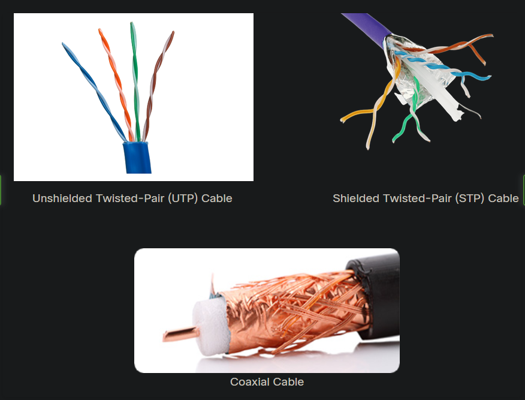

# 🌐 4.3 Copper Cabling

**Cisco Networking Academy | Solent University**

**Course:** CCNA: Introduction to Networks  
**Module:** 04 - Physical Layer  
**Focus Area:** Copper Cable Characteristics, Interference, UTP, STP and Coaxial Cables

## 🎯 Objective

Understand how copper cables transmit data using electrical signals, the factors that affect signal quality, and the differences between UTP, STP and coaxial cabling.

## 🧠 4.3.1 Characteristics of Copper Cabling

**Copper cabling** is commonly used in networks to transmit data using electrical signals.

Copper cables are widely used because they are relatively inexpensive, easy to install and supported by many networking devices.

However, copper cabling has limitations.

### Signal Attenuation

**Attenuation** is the gradual loss of signal strength as it travels through a cable.

- Longer cables generally experience more attenuation.
- Excessive attenuation can cause communication errors.
- Ethernet copper connections commonly have a maximum channel length of **100 metres** for standard twisted-pair installations.

### Electromagnetic Interference (EMI)

**EMI (Electromagnetic Interference)** occurs when external electromagnetic sources interfere with electrical signals travelling through a cable.

**Examples:**
- Electrical motors.
- Power cables.
- Fluorescent lighting and other electrical equipment.

This interference introduces **electrical noise**, which can distort signals and cause data transmission errors.

EMI can be reduced by using **shielded cables** and keeping network cables away from sources of electrical interference.

### Radio Frequency Interference (RFI)

**RFI (Radio Frequency Interference)** is interference caused by radio-frequency electromagnetic signals.

**Examples:**
- Radio transmitters.
- Wireless communication equipment.
- Other sources of radio-frequency energy.

### Crosstalk

**Crosstalk** occurs when signals travelling through one pair of wires interfere with signals in another pair.

Twisting the wire pairs helps reduce crosstalk.

> **NOTE:** Correct cable installation, suitable cable types and appropriate cable lengths help reduce signal degradation and interference.

## 🧠 4.3.2 Types of Copper Cabling

Three common types of copper network cables are:

| Cable Type | Main Characteristic | Common Use |
|---|---|---|
| **UTP (Unshielded Twisted-Pair)** | Twisted wire pairs without additional metallic shielding. | Ethernet LAN connections. |
| **STP (Shielded Twisted-Pair)** | Twisted wire pairs with shielding to reduce interference. | Networks with higher electromagnetic interference. |
| **Coaxial Cable** | Central copper conductor surrounded by insulation and shielding. | Cable broadband and certain other communication systems. |

Each type uses copper conductors but differs in construction, protection against interference and typical applications.

## 🧠 4.3.3 Unshielded Twisted-Pair (UTP)

**UTP (Unshielded Twisted-Pair)** is one of the most commonly used cable types in Ethernet LANs.

A typical UTP Ethernet cable contains **four pairs of copper wires (eight wires in total)**.

The wires are twisted together in pairs to help reduce EMI and crosstalk.

### UTP Characteristics

- Contains four twisted pairs of copper wires.
- Does not have additional metallic shielding.
- Relatively inexpensive and flexible.
- Commonly uses RJ-45 connectors.
- Supports different Ethernet speeds depending on the cable category and network equipment.

> **NOTE:** The twists in UTP cables help reduce interference without requiring additional metallic shielding.

## 🧠 4.3.4 Shielded Twisted-Pair (STP)

**STP (Shielded Twisted-Pair)** uses twisted copper wire pairs with additional metallic shielding to reduce electromagnetic interference.

The shielding may surround individual wire pairs, the entire cable, or both, depending on the cable design.

### STP Characteristics

- Uses twisted copper wire pairs and RJ-45 connector. 
- Includes metallic shielding for additional interference protection.
- Often more expensive and less flexible than UTP.
- Requires suitable shielded connectors and correct installation to achieve its intended protection.

### When Is STP Useful?

STP may be used in environments with higher levels of electrical interference.

**Examples:**
- Industrial facilities.
- Manufacturing environments.
- Locations with heavy electrical machinery.

> **Remember:** Both UTP and STP use twisted wire pairs. The main difference is the additional shielding in STP.

## 🧠 4.3.5 Coaxial Cable

**Coaxial cable** is a copper cable designed with a central conductor surrounded by insulation and metallic shielding.

Its construction helps protect the signal from external electromagnetic interference.

### Coaxial Cable Structure

A typical coaxial cable contains:
1. **Central conductor:** Carries the electrical signal.
2. **Insulating layer:** Separates the central conductor from the outer shield.
3. **Metallic shield:** Helps protect against electromagnetic interference and acts as part of the signal path.
4. **Outer jacket:** Protects the cable from physical damage.

### Common Uses

Coaxial cables are used for:
- Cable television systems.
- Cable broadband Internet connections.
- Certain radio-frequency communication systems.
- Some CCTV installations.

**Example:**
- A cable Internet provider may use coaxial cabling to connect its network infrastructure to a customer's cable modem.
- The modem then provides network connectivity to the customer's router or other devices.

> **NOTE:** Coaxial cable was also used in older Ethernet technologies, but modern wired Ethernet LANs commonly use twisted-pair or fibre-optic cabling.

There are different types of connectors used with coax cable: 
- The Bayonet Neil-Concelman (BNC)
- N Type 
- F Type

## 📌 Key Concepts to Remember

- **Copper Cabling:** Transmits data using electrical signals.
- **Attenuation:** Loss of signal strength over distance.
- **EMI/RFI:** External electromagnetic interference that can affect signal quality.
- **Crosstalk:** Interference between wire pairs.
- **UTP:** Twisted-pair cable without additional metallic shielding.
- **STP:** Twisted-pair cable with additional shielding.
- **Coaxial Cable:** Uses a central conductor surrounded by insulation and shielding.
- **100-Metre Limit:** Common maximum channel length for standard twisted-pair Ethernet connections.

## 🔐 Security Relevance

- **Physical Cable Access:** Unauthorised access to network cabling may allow an attacker to interfere with communications.
- **Cable Tapping:** Copper signals may be intercepted using specialised equipment and physical access.
- **Denial-of-Service (DoS):** Cutting or disconnecting network cables can interrupt services.
- **Interference:** Electrical interference or poor cabling can cause errors and reduce network availability.
- **Physical Protection:** Securing network cabinets, cable routes and connection points helps protect network infrastructure.