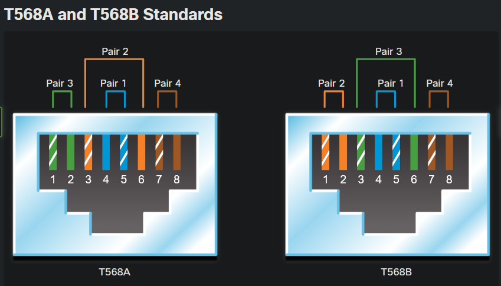

# 🌐 4.4 UTP Cabling

**Cisco Networking Academy | Solent University**

**Course:** CCNA: Introduction to Networks  
**Module:** 04 - Physical Layer  
**Focus Area:** UTP Properties, Cabling Standards, Connectors and Wiring Arrangements

## 🎯 Objective

Understand how UTP cabling reduces interference, identify common cabling standards and connectors, and distinguish between straight-through and crossover Ethernet cables.

## 🧠 4.4.1 Properties of UTP Cabling

UTP cables do not use additional metallic shielding to protect against interference. Instead, they rely on the following techniques:

### Cancellation

Electrical signals travelling through the two wires in a twisted pair create opposing electromagnetic fields.

These opposing fields help cancel each other, and also helps reduce the effects of external electromagnetic interference.

### Varying the Number of Twists

Each wire pair has a different number of twists per unit of length.

UTP cables must follow precise specifications regarding the twisting of wire pairs permitted per metre. 

This helps reduce interference between neighbouring wire pairs within the cable.

> **NOTE:** Twisting the wires reduces interference but does not completely eliminate it.

## 🧠 4.4.2 UTP Cabling Standards and Connectors

UTP cabling follows industry standards to ensure compatibility, reliability and consistent network performance.

### Cabling Standards

- **TIA (Telecommunications Industry Association):** Defines standards for cable construction, connectors, wiring arrangements and installation.
- **IEEE (Institute of Electrical and Electronics Engineers):** Defines Ethernet standards, including data rates and physical transmission requirements.

#### TIA/EIA - 568

This standard defines the commercial cabling requirements for LAN installations.

Some of the elements defined are: 
- Cable Types.
- Cable Lengths.
- Connectors.
- Cable Termination.
- Cable testing methods. 

### UTP Cable Categories

The electrical characteristics of cooper cabling are defined by IEEE. 
They rates UTP cabling according to its performance, especially on their ability to carry higher bandwith rates.

UTP Cable Categories: 
1. Cat 3 (10 Mbps):
- Originally used for voice communication and later for data transmission. 
2. Cat 5 (100 Mbps - Fast Ethernet) and Cat 5e  (1 Gbps)
3. Cat 6 (1 Gbps up to 100 m; 10 Gbps over shorter distances) and Cat 6A (10 Gbps up to 100 m) 

> NOTE: 
> - Some manufacturers are making cables exceeding the TIA/EIA Category 6a specifications.
> - Cat 7 and Cat 8 use additional metallic shielding and are therefore not classified as UTP.

4. Cat 7 (10 Gbps up to 100 m)
5. Cat 8 (25 or 40 Gbps up to 30 m)

### RJ-45 Connector

UTP Ethernet cables commonly use an eight-pin modular connector known as an **RJ-45 connector**.

The connector connects the eight copper wires to the Ethernet interface of a networking device.

**Correct cable termination is important to maintain signal quality and prevent communication errors.**

#### Wiring Standards: T568A and T568B

The **T568A** and **T568B** wiring standards define the order in which the eight copper wires are connected to the connector pins.

The main difference between the two standards is the position of the **green and orange wire pairs**.

## 🧠 4.4.3 Straight-through and Crossover UTP Cables

Different wiring arrangements determine how the pins at one end of a cable connect to the pins at the other end.

### Ethernet Straight-through Cable

A **straight-through cable** uses the same wiring standard at both ends.

- **T568A** → **T568A**
- **T568B** → **T568B**

Traditionally used to connect different types of networking interfaces:
- PC → Switch
- Router → Switch
- Server → Switch

### Ethernet Crossover Cable

A traditional Ethernet **crossover cable** uses different wiring standards at each end.

- **T568A** → **T568B**

This arrangement is used to interconnect similar devices to communicate directly:
- PC → PC
- Switch → Switch
- Router → Router
- PC → Router

#### Why Do We Need Different Wiring Arrangements?

For Ethernet communication to work, the transmitting pins (TX) of one device must connect to the receiving pins (RX) of the other device.

Straight-through cable: Used when devices have opposite TX and RX pin arrangements (e.g. PC → Switch).

Crossover cable: Used when devices have identical TX and RX pin arrangements (e.g. PC → PC).

Using T568A at one end and T568B at the other swaps the green and orange wire pairs, ensuring that TX connects to RX.

> NOTE: These traditional wiring arrangements apply to 10/100 Mbps Ethernet. Modern devices commonly use Auto-MDIX to adjust automatically.

### Auto-MDIX

**Auto-MDIX (Automatic Medium-Dependent Interface Crossover)** allows a network interface to automatically detect and adjust to the required wiring arrangement.

Most modern Ethernet devices support this feature, reducing the need to manually select between straight-through and crossover cables.

> **NOTE:** The traditional cable selection rules are still important for understanding Ethernet communication.

## 📌 Key Concepts to Remember

- **Cancellation:** Opposing electromagnetic fields help reduce interference.
- **Wire Twisting:** Reduces interference between wire pairs.
- **RJ-45:** Common connector used for twisted-pair Ethernet connections.
- **T568A and T568B:** Define the wiring arrangement of the eight connector pins.
- **Straight-through:** Same wiring standard at both ends.
- **Crossover:** Crosses the appropriate wire pairs between the two ends.
- **Auto-MDIX:** Automatically adjusts the interface to the required wiring arrangement.

## 🔐 Security Relevance

- **Unauthorised Connections:** Unused Ethernet ports may allow unauthorised devices to connect to the network.
- **Physical Access:** Network cables and connectors should be protected against tampering and interception.
- **Network Availability:** Incorrect cable termination, damaged cables or excessive interference can cause communication failures.
- **Preventive Measures:** Secure network cabinets, restrict physical access and disable unused switch ports.