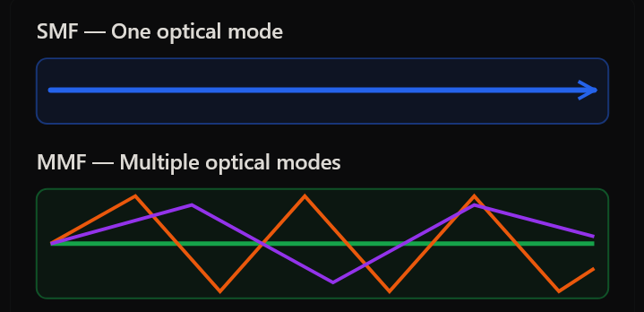
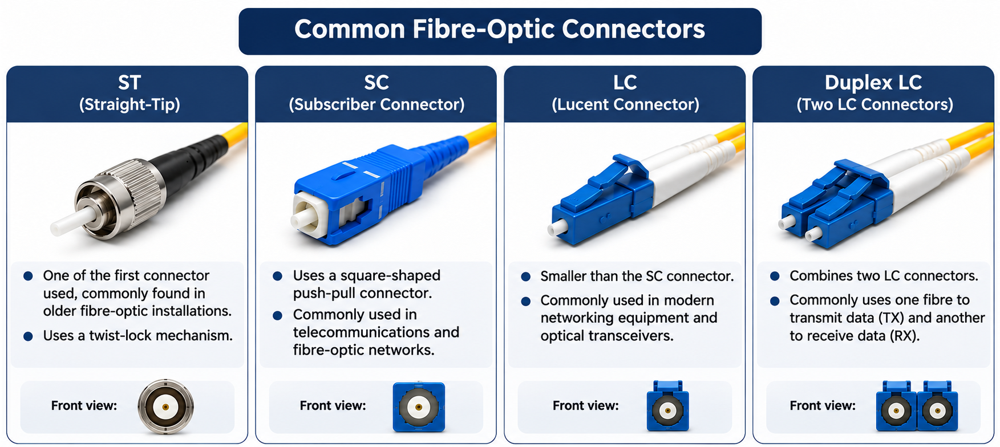
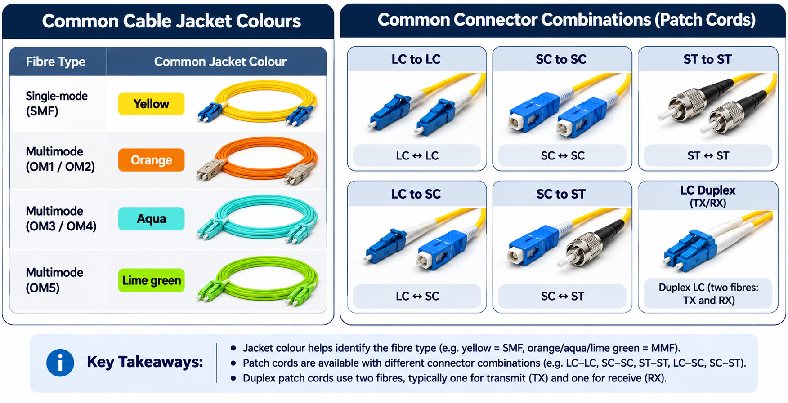

# 🌐 4.5 Fibre-Optic Cabling

**Cisco Networking Academy | Solent University**

**Course:** CCNA: Introduction to Networks  
**Module:** 04 - Physical Layer  
**Focus Area:** Fibre-Optic Properties, Media Types, Connectors and Applications

## 🎯 Objective

Understand how fibre-optic cabling transmits data using light signals, identify different types of fibre media and connectors, and understand the advantages and limitations of fibre compared to copper cabling.

## 🧠 4.5.1 Properties of Fibre-Optic Cabling

**Fibre-optic cabling** transmits data using pulses of light travelling through thin, flexible strands of glass or plastic.

Unlike copper cabling, which uses electrical signals, fibre-optic cabling uses optical signals to represent and transmit binary data.

### Advantages

- Transmits data over longer distances.
- Supports higher bandwidths than any other network media.
- Experiences lower signal attenuation than copper.
- Completely immune to electromagnetic interference (EMI) and radio frequency interference (RFI).

### Limitations

- Can be more expensive to install.
- Requires specialised equipment and installation skills.
- Excessive bending can cause signal loss or damage.

> **NOTE:** Fibre-optic cabling does not eliminate attenuation, but generally experiences significantly less signal loss over long distances than copper cabling.

## 🧠 4.5.2 Types of Fibre Media

There are two main types of fibre-optic media:

- Single-Mode Fibre (SMF).
- Multimode Fibre (MMF).

### Single-Mode Fibre (SMF)

**Single-Mode Fibre** uses a very small core and a laser light source to transmit light in a single optical mode.

Characteristics:

- Small core diameter (approximately 9 µm).
- Uses laser light sources (expensive technology).
- Supports long-distance transmission (even hundreds of km).
- Experiences minimal modal dispersion.

**Common uses:** Telecommunications networks, ISP infrastructure and long-distance network connections.

### Multimode Fibre (MMF)

**Multimode Fibre** uses a larger core that allows light to travel through multiple optical paths.

Characteristics:

- Larger core diameter (typically 50 or 62.5 µm).
- Uses LED or laser light sources, depending on the technology.
- Commonly used for shorter-distance connections.
- Common in LANs and data centres, often using cost-advantage optical equipment.
- Information is released at different angles, which can follow different paths.
- Experiences modal dispersion.

#### SMF vs MMF – Light Propagation and Modal Dispersion

- SMF: Light travels in a single optical mode, avoiding modal dispersion.
- MMF: Light travels through multiple optical modes, following different paths.

**Modal dispersion** occurs when light from the same pulse arrives at the receiver at slightly different times.

This causes pulses to spread and potentially overlap, making individual bits harder to distinguish and limiting transmission distance.

## 🧠 4.5.3 Fibre-Optic Cabling Usage

Fibre-optic cabling is commonly used in the following environments:

### Enterprise Networks
- Used to interconnect networking devices, particularly backbone switches and connections between buildings.

### Fibre to the Home (FTTH)
- Used by Internet Service Providers (ISPs) to deliver high-speed Internet connections directly to residential properties.

### Long-Haul Networks
- Used to transmit data over long distances, connecting cities and countries.

### Submarine Cable Networks
- Used to connect countries and continents through fibre-optic cables installed beneath oceans.

> **NOTE:** Submarine fibre-optic cables form a major part of the global Internet infrastructure.

## 🧠 4.5.4 Fibre-Optic Connectors

Fibre-optic connectors connect optical fibres to networking equipment while ensuring accurate alignment and minimal signal loss.

Common fibre-optic connectors include:

> **NOTE:** The main differences among the types of connectors are dimensions and methods of coupling. 
> **NOTE:** Fibre-optic connectors must be clean and correctly aligned to prevent signal attenuation and communication errors.

## 🧠 4.5.5 Fibre Patch Cords

A **fibre patch cord** is a fibre-optic cable with connectors installed at both ends.
It is used to connect networking equipment, optical transceivers and fibre patch panels.

### Simplex and Duplex Patch Cords

- **Simplex:** Contains one optical fibre.
- **Duplex:** Contains two optical fibres, commonly providing separate paths for transmitting and receiving data.

### Common Cable Jacket Colours

## 🧠 4.5.6 Copper versus Fibre-Optic Comparison

Both fibre-optic and copper cables transmit data, but they use different physical signalling methods.

In enterprise networks, fibre-optic cabling is commonly used for high-bandwidth backbone connections, particularly between switches and buildings across a campus.

| Characteristic | Copper | Fibre-Optic |
|---|---|---|
| Signal type | Electrical signals | Light signals |
| Transmission medium | Copper conductors | Glass or plastic fibres |
| Bandwidth potential | Lower | Higher |
| Transmission distance | Shorter | Longer |
| Attenuation | Generally higher | Generally lower |
| EMI and RFI | Low | Immune |
| Installation | Generally easier | Requires specialised skills |
| Installation costs | Generally lower | Generally higher |
| Power over Ethernet (PoE) | Supported | Not supported by optical fibre |

> **Note:** Power over Ethernet (PoE) is a technology that allows an Ethernet cable to carry both data and electrical power at the same time.

### Example: Choosing the Network Medium

- **PC → Switch:** Copper Ethernet cabling is commonly used for short-distance LAN connections.
- **Switch → Switch (between buildings):** Fibre-optic cabling is commonly used because it supports longer distances and is immune to electromagnetic interference.

> **Remember:** Fibre-optic cabling is not always the best choice. The appropriate network medium depends on distance, bandwidth requirements, installation cost and environmental conditions.

## 📌 Key Concepts to Remember

- **Fibre-Optic Cabling:** Transmits data using light signals.
- **SMF:** Uses a small core and supports long-distance transmission.
- **MMF:** Uses a larger core and supports multiple optical paths.
- **Modal Dispersion:** Spreading of light pulses due to different propagation paths.
- **ST, SC and LC:** Common fibre-optic connector types.
- **Fibre Patch Cord:** Fibre-optic cable with connectors installed at both ends.
- **EMI/RFI:** Fibre-optic transmission is immune to electromagnetic and radio frequency interference.

## 🔐 Security Relevance

- **Data Interception:** Fibre-optic signals are generally more difficult to intercept than copper signals, but fibre tapping is still possible.
- **Physical Security:** Fibre cables, connectors and patch panels must be protected against unauthorised access.
- **Network Availability:** Cutting, disconnecting or excessively bending fibre cables can interrupt network communication.
- **Interference Resistance:** Immunity to EMI and RFI helps maintain reliable communication in environments with electrical interference.
- **Preventive Measures:** Secure cable routes, restrict physical access and monitor network links for unexpected signal loss.